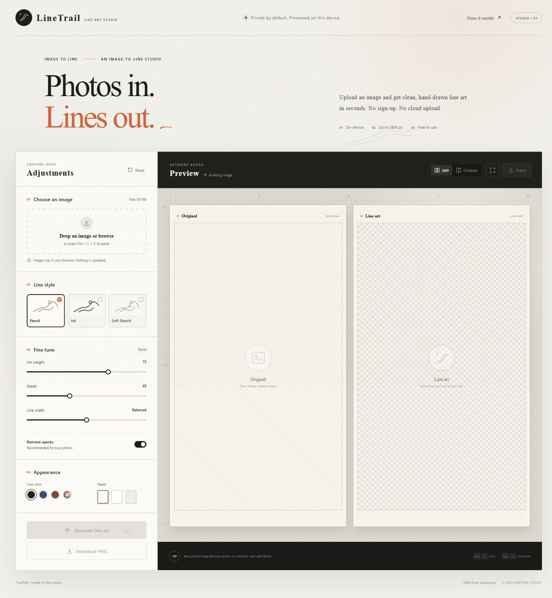
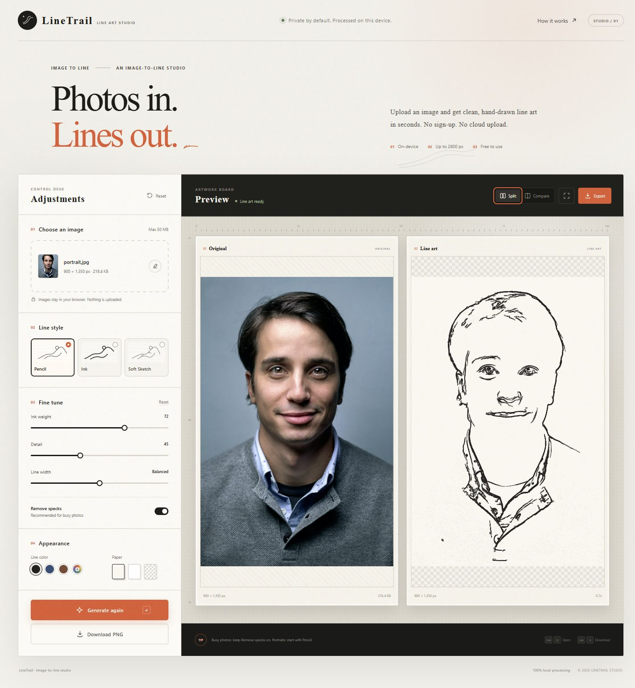
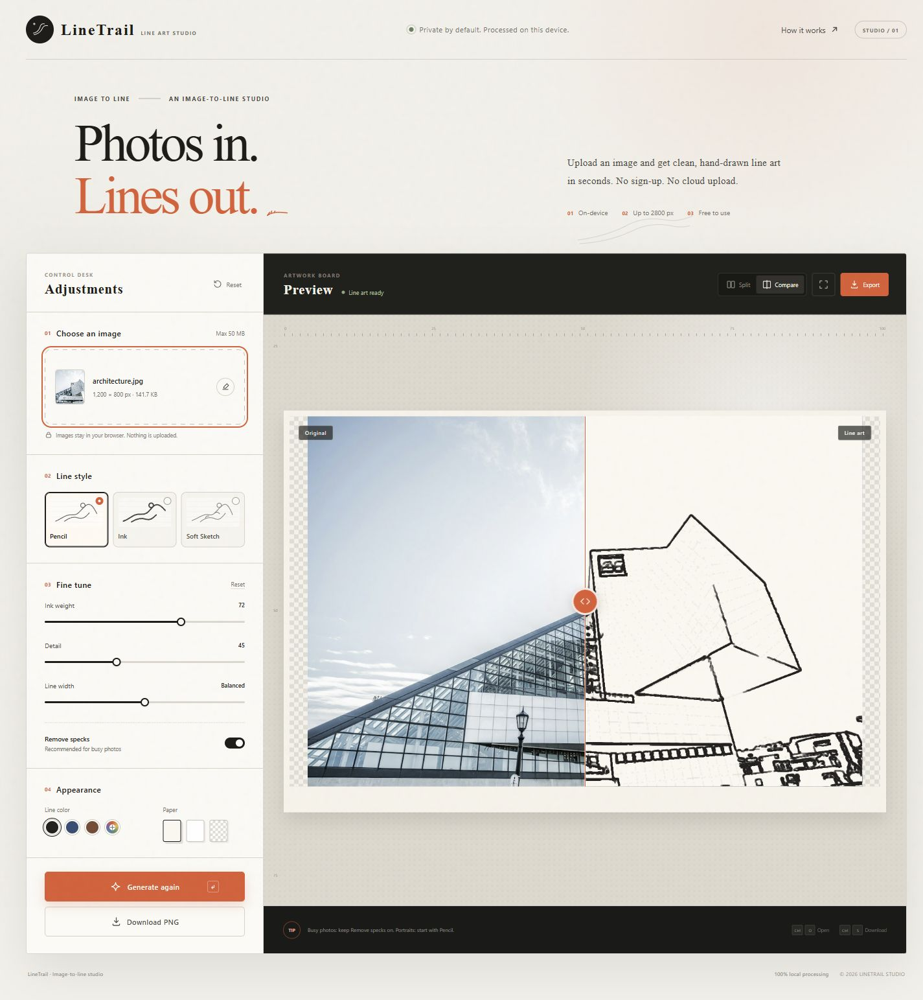

# LineTrail

**Turn any image into clean line art—locally, in your browser.**

[Live demo](https://zhuanght-1201.github.io/linetrail/) · [Features](#features) · [Run locally](#run-locally)



## Features

- One-click conversion with automatic first draft
- Pencil, Ink, and Soft Sketch styles
- Adjustable ink weight, detail, line width, and cleanup
- Preset or custom line colors
- Warm, white, or transparent backgrounds
- Split and draggable comparison views
- High-resolution PNG export
- 100% client-side processing; images never leave the browser

## Effects

**Portrait · Original vs. Pencil**



**Architecture · Draggable comparison**



## Run locally

```bash
npm install
npm run dev
```

Open the local URL shown in the terminal. You can also open `index.html` directly; LineTrail falls back to main-thread processing when browser security blocks Web Workers.

### Production build

```bash
npm run build
```

The static output is written to `dist/`.

## How it works

`line-art.js` combines edge-preserving bilateral filtering, median denoising, Sobel edge detection, non-maximum suppression, hysteresis thresholding, local tone rendering, and small-component cleanup. Processing runs in a Web Worker and output remains entirely on the user's device.

No API keys, accounts, servers, or image uploads are required.

## Stack

HTML · CSS · Vanilla JavaScript · Canvas · Web Workers · Vite

## License

[MIT](LICENSE)
